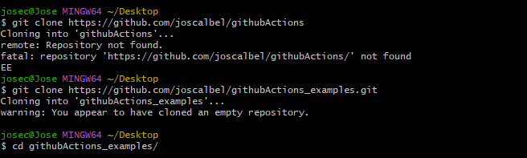
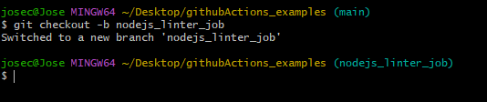
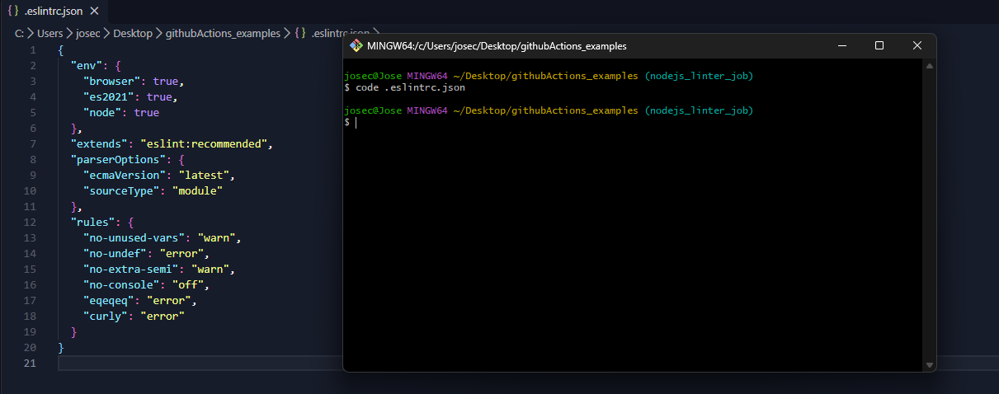
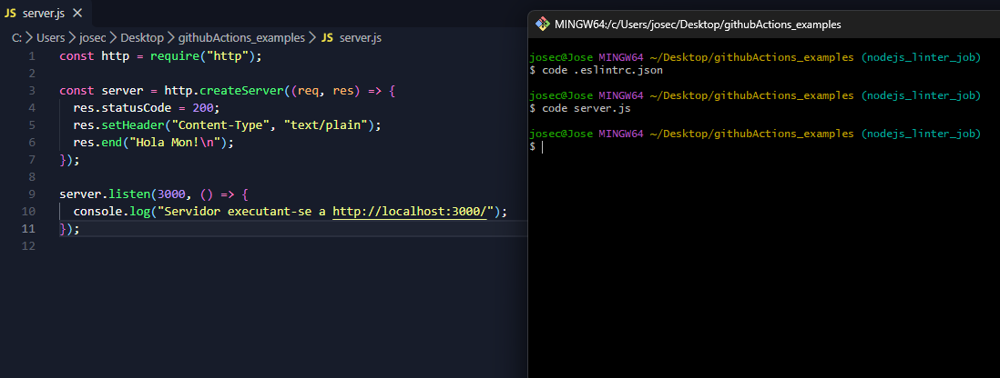
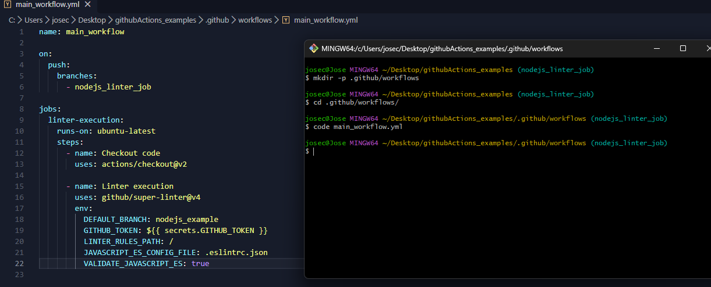
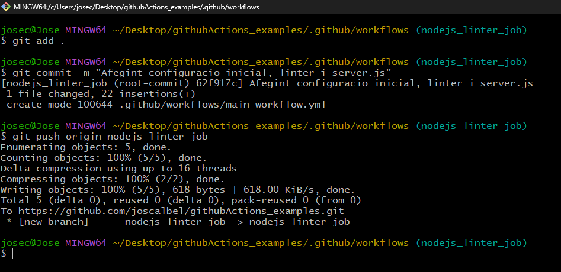

## Pas 1: Crear el repositori a GitHub i clonar-lo (o inicialitzar-lo localment)

---
## Pas 2: Crear i canviar a la nova branca

---
## Pas 3: Crear el fitxer de configuració del Linter (.eslintrc.json)

---
## Pas 4: Crear l'aplicació Node.js d'exemple (server.js)

---
## Pas 5: Crear el workflow de GitHub Actions (main_workflow.yml)

---
## Pas 6: Pujar el codi correcte i verificar el primer èxit ❌

---
